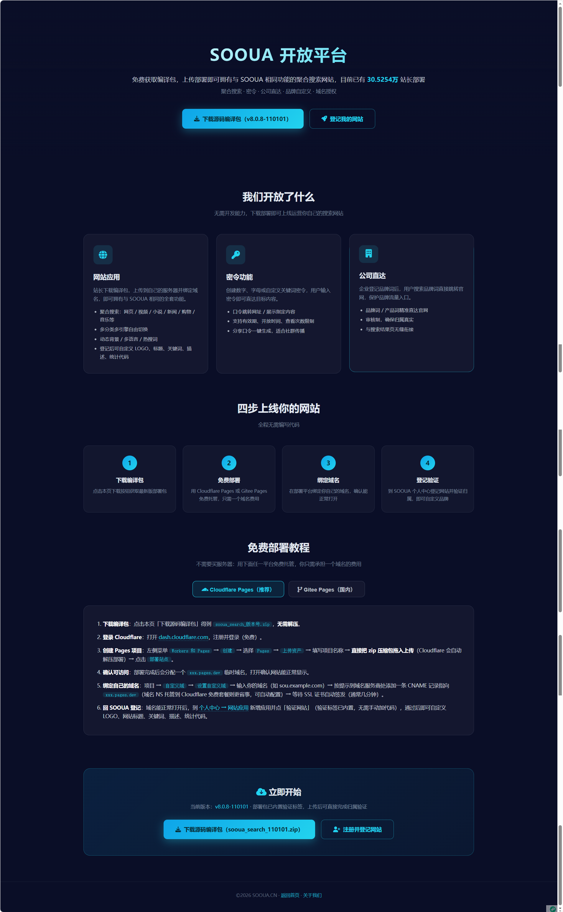
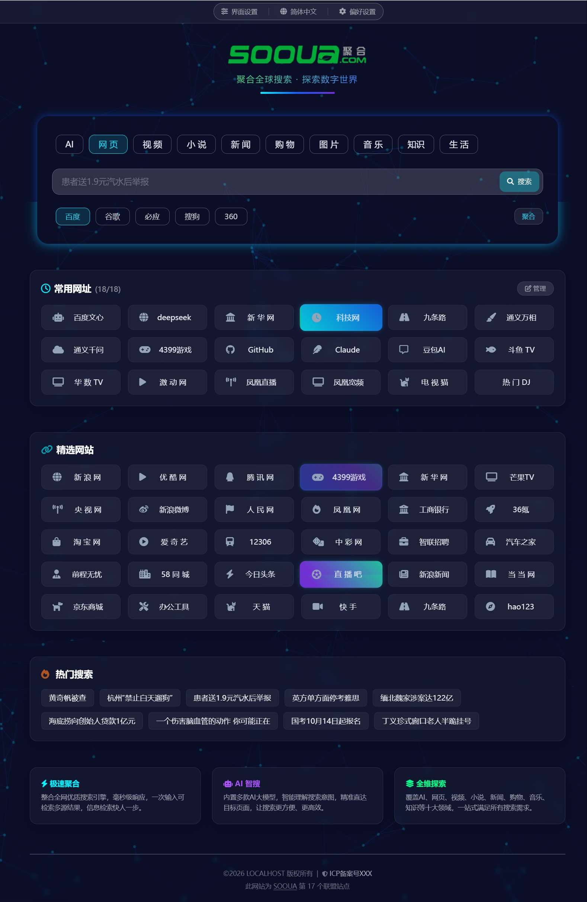
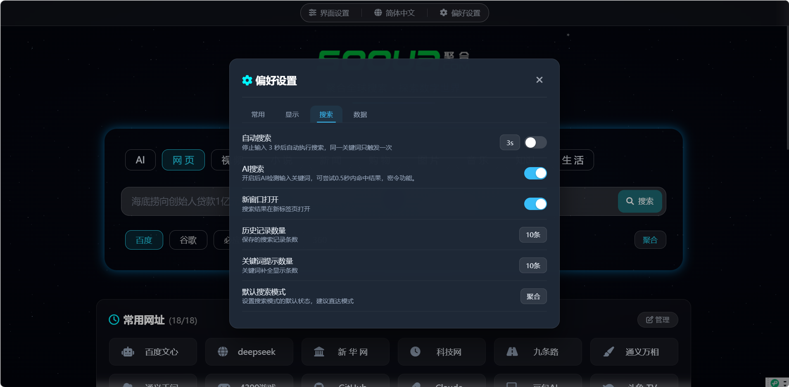
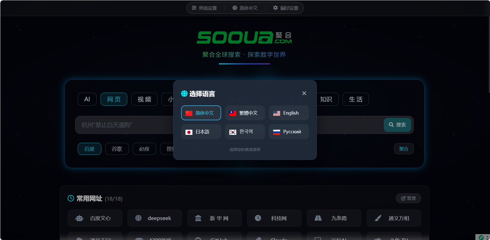
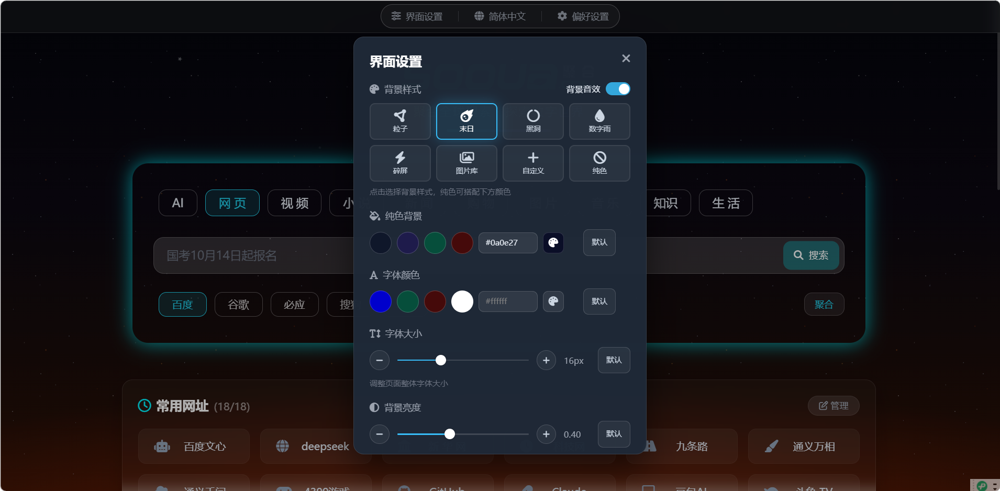

# SOOUA SEARCH 站点部署包

SOOUA Search 聚合搜索引擎的站点部署包（纯静态 H5）。下载部署到自己的服务器并绑定域名，即可拥有与 [SOOUA 主站](https://www.sooua.cn) 同款的聚合搜索站点。包内已内置站点验证标签，**无需修改任何代码**。

- 官方主站：https://www.sooua.cn
- 使用文档：https://doc.sooua.cn/index.php/article/5/936421724042297344.html
- 免费部署教程：https://www.sooua.cn/index/open.html

## 下载

| 版本 | 部署包 |
| --- | --- |
| v110901 | [dist/sooua_search_110901.zip](dist/sooua_search_110901.zip)（当前最新） |

仓库只保留当前最新版，下载后直接解压上传即可。

## 更新日志

### v110901（2026-11-09）

- **首页实用工具**：精选网站下新增「实用工具」卡片，PC 端可直接在弹窗内使用工具，并新增弹窗开关与最近使用排序
- **新增工具**：万年历（农历 / 节气 / 节日）、周公解梦（词库检索）、彩票自定义彩种（自定义名称、号池、每注个数与倍数）
- **算命运势**：新增今日 / 明日 / 今年 / 明年运势，支持账号积分「逆天改命」，分数与事业 / 财运 / 健康文案同步变好
- **工资时钟**：上下班时间一行设置，按秒实时跳动今日到手工资
- **分享升级**：复制链接的同时弹出二维码，微信或浏览器扫码即可进入对应页面
- **体验优化**：纪念日支持点按删除、图片水印与保存适配、骰子手感、JSON / 编码 / 压缩工具细节修正

### v110801（2026-11-08）

- 聚合搜索首页、直达 / 聚合双模式、密令、网址导航、多背景与亮暗主题等基础能力

## 功能说明

### 聚合搜索

- **10 大搜索分类**：AI / 网页 / 视频 / 小说 / 新闻 / 购物 / 图片 / 音乐 / 知识 / 生活
- **50+ 垂直搜索引擎**：百度、谷歌、必应、搜狗、360、头条、知乎、CSDN、淘宝、京东、酷狗、起点……
- 切换分类时，搜索引擎列表、热搜词、精选网站三块内容同步刷新
- 引擎记忆：每个分类记住你上次选的引擎，下次进入自动恢复

### 智能输入

- **搜索历史**：点击空输入框自动弹出，支持单条删除与一键清空，条数可调（5/10/20/50）
- **关键词提示**：输入即实时补全，支持 `↑` `↓` 选择、`Enter` 直搜
- **自动搜索**：停止输入后自动执行，延迟可选 2 / 2.5 / 3 / 3.5 / 4 秒
- 快捷键：`Esc` 清空、`Alt` 关闭面板、`Enter` 搜索、`↑`/`↓` 上下选择

### 直达 / 聚合双模式

- **直达模式**：视频 / 音乐 / 小说分类直接跳转内容卡片，一步看到可播放、可阅读的结果；其余分类优先直达官网或目标站，未命中自动回落聚合结果页
- **聚合模式**：直接跳到所选搜索引擎的原始结果页，不停留中间页
- 模式自动记忆，也可在偏好设置中设定默认模式

### AI 搜索与密令

- **AI 搜索**：输入关键词后在 0.5 秒内智能命中直达链接（默认开启）
- **密令系统**：输入 13 位大写字母或 13 位数字密令，云端解析后直接跳转
- 命中后首页标语区域变色 + 流光动画提示，点击标语直达目标页

### 网址导航

- **精选网站**：每个分类下配优质站点入口，点击即在新标签页打开
- **常用网址**：自动记录你点过的网站（最多 18 条），按访问时间倒序，支持单条删除 / 批量清空 / 整块隐藏
- **热搜词轮播**：输入框占位符每 5 秒轮播当前分类热门词，点击即搜

### 个性化定制

- **8 种背景**：粒子、流光、气泡、数字雨、星云、图片库、自定义图片、纯色
- **亮 / 暗双主题**：一键切换，卡片、弹窗、底部导航整套跟随
- **字体颜色**：预设色 + 取色盘 + 十六进制输入，实时生效
- **字体大小**：12px ～ 24px 无级调节，一键恢复默认
- 全部界面设置自动保存在本地，下次访问原样恢复

### 多语言

简体中文、繁體中文、English、日本語、한국어、Русский 共 6 种界面语言，一键切换并记忆。

### 数据与隐私

- 搜索历史、网址记录、偏好设置、界面设置全部保存在浏览器本地（localStorage），不上传服务器
- 支持 JSON 一键导出 / 导入，可整站迁移个人配置
- 支持关闭浏览器自动清理、按 7 / 30 / 90 天周期自动清理旧数据

### 全端适配

PC、平板、手机三端响应式布局，浏览器、微信内置浏览器、添加到桌面后均可直接使用。

## 安装说明

### 1. 部署站点文件

1. 下载 [`dist/`](dist/) 目录下的最新站点包 `sooua_search_<版本号>.zip`
2. 解压后把全部文件上传到网站根目录
3. 绑定域名，建议开启 HTTPS
4. 访问 `https://你的域名/`，能正常打开页面即部署成功

站点文件为纯静态文件，无数据库、无后端依赖，可放在任意静态空间 / 虚拟主机（Nginx、Apache、PHP 空间、对象存储均可）。

### 2. 接入 SOOUA 开放平台

1. 打开 [SOOUA 个人中心](https://www.sooua.cn) 注册 / 登录
2. 进入「网站应用」→「新增应用」，填写你的域名
3. 点击「验证网站」——验证标签已内置在站点文件中，无需改任何代码
4. 验证通过即接入完成，搜索、直达、密令、热搜等数据由 SOOUA 开放 API 提供

### 3. 自定义站点

验证通过后，在个人中心即可修改站点标题、关键词、描述、LOGO、首页标语（含链接）、ICP / 公安备案号、统计代码、广告位，接口按域名自动下发，改完刷新即生效，无需重新部署。

### 4. 版本更新

个人中心「网站应用」列表常显当前部署版本与最新版本，版本过旧会黄色提醒；点「下载最新版」获取新包，重新上传覆盖即可。

## 截图

问题反馈与商务合作：微信 qq697553
